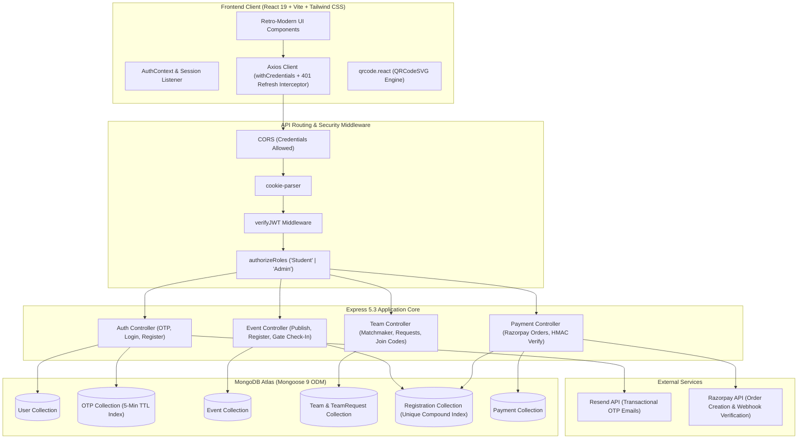
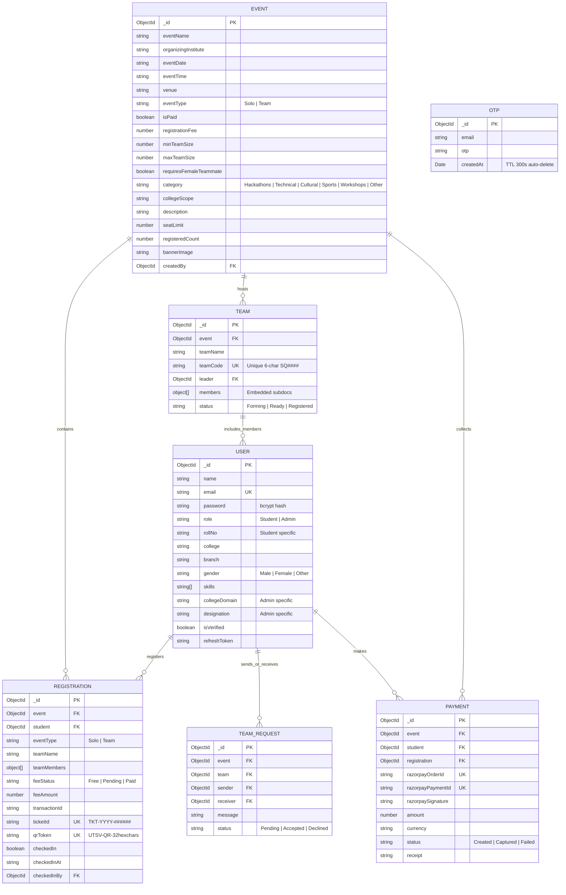
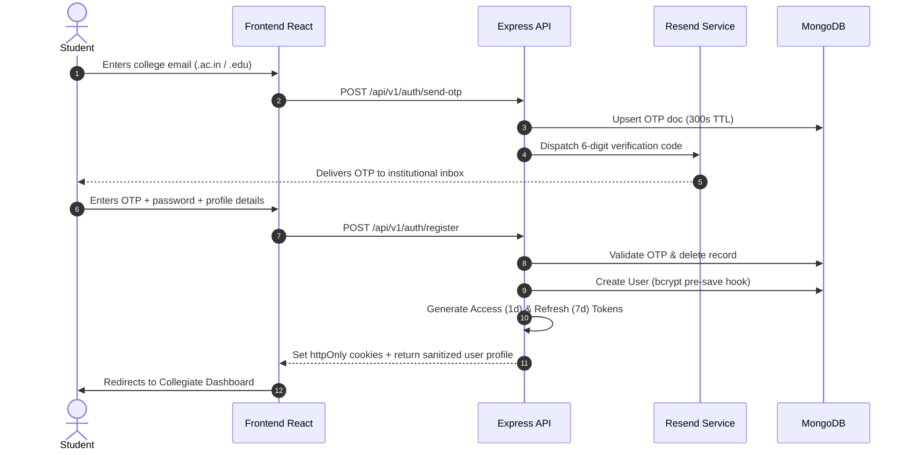
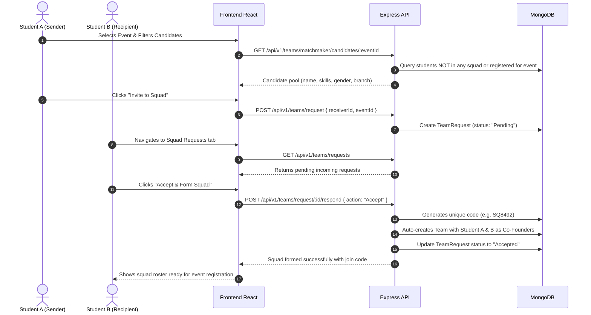
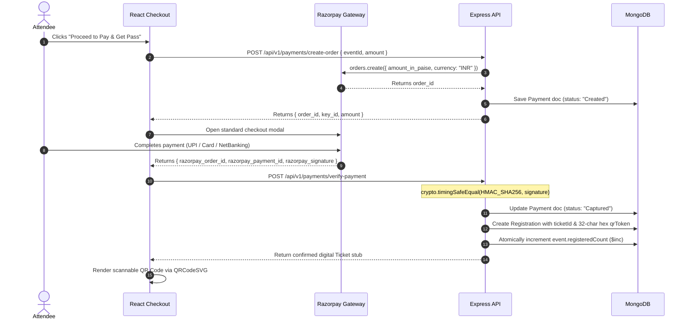
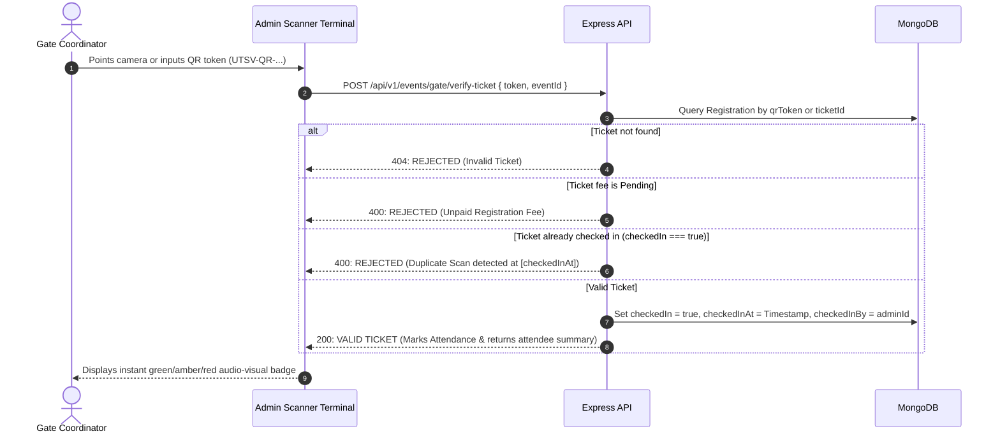

# 🎪 UtsavHub — Collegiate Event & Squad Management Platform

> **An automated, collegiate event management, algorithmic solo team-matching, and cryptographic QR gate check-in system built on the MERN stack.**

---

## 📌 Executive Overview

**UtsavHub** bridges the operational gap between collegiate event organizers and participating students. It eliminates paper registrations, manual squad formation hassles, and unverified event admission by providing:

1. **Domain-Restricted Authentication & 2FA OTP:** Verified institutional registration powered by Resend email dispatch and dual-cookie JWT architecture.
2. **TeamSync Solo Matchmaker:** Algorithmic squad pairing for solo participants with strict **Gender Diversity Mandate** enforcement.
3. **Razorpay Standard Gateway:** Cryptographic SHA-256 HMAC transaction verification for paid events with instant digital pass issuance.
4. **Cryptographic QR Pass & Gate Scanner Terminal:** Scannable digital ticket stubs with hardware/camera scanning, instant check-in verification, and strict duplicate-entry rejection.
5. **Admin Operations & Telemetry:** Real-time seat caps, financial audits, attendee rosters, and one-click CSV export.

---

## 🏛️ System Architecture



---

## 🗄️ Database Entity Relationship (ER) Diagram



---

## ⚡ Core Workflows

### 1. Two-Factor Authentication & Refresh Rotation



---

### 2. TeamSync Solo Matchmaker & Auto Squad Creation



---

### 3. Payment Verification & Digital Ticket Generation



---

### 4. Gate Terminal QR Code Verification



---

## 🛠️ Technology Stack

| Layer | Technologies |
|---|---|
| **Frontend Framework** | React 19, Vite 8, React DOM |
| **Styling & Icons** | Tailwind CSS (Retro-warm collegiate theme), Lucide React, Google Material Symbols |
| **Animation & Rendering** | Motion (`motion/react`), `qrcode.react` (`QRCodeSVG`) |
| **State & Networking** | React Context (`AuthContext`, `ToastContext`), Axios (with credentials & interceptors) |
| **Backend Runtime** | Node.js (ES Modules, `"type": "module"`), Express 5.3.0 |
| **Database & ODM** | MongoDB Atlas, Mongoose 9.12.2 |
| **Authentication & Crypto** | JSON Web Tokens (`jsonwebtoken`), `bcrypt` (10 salt rounds), Node.js `crypto` (`timingSafeEqual`, `randomBytes`) |
| **Payment Gateway** | Razorpay SDK (Standard Checkout, SHA-256 HMAC signature verification) |
| **Email Communication** | Resend Transactional Email API |

---

## 🚀 Key Features

### 🎓 For Students
- **Collegiate Directory:** Filter events by category (Hackathons, Technical, Cultural, Sports, Workshops), campus scope, and fee status.
- **TeamSync Matchmaker:** Discover solo candidates by branch and skills; send and receive squad invites with automatic squad creation.
- **Squad Code Join:** Join existing teams instantly by entering secret squad codes (`SQ####`).
- **Gender Diversity Compliance:** Real-time badge indicators alerting whether a squad satisfies mandatory diversity mandates.
- **Digital Passbook:** View verified tickets with scannable QR codes, seat allocation details, attendee info, and one-click print/save pass stubs.

### 🛡️ For Organizers & College Admins
- **Event Publishing Console:** Define seat limits, team size constraints (min/max), diversity mandates, registration fees, and treasury payout details.
- **Admin Gate Scanner Terminal:** Decode QR passes via webcam/mobile camera or manual token entry with millisecond verification speed.
- **Duplicate Entry Defense:** Blocks reuse of passes; surfaces original check-in timestamp and operator ID.
- **Financial & Revenue Audits:** Track captured vs pending transactions, total gross revenue, and registration counts.
- **Accreditation Export:** Download complete attendee rosters with roll numbers, contact info, check-in status, and payment references as CSV.

---

## 📋 Comprehensive API Reference

### 🔐 Authentication (`/api/v1/auth`)

| Method | Endpoint | Auth Required | Description | Request Body |
|---|---|---|---|---|
| `POST` | `/send-otp` | No | Sends 6-digit OTP to institutional email | `{ "email": "student@college.ac.in" }` |
| `POST` | `/register` | No | Verifies OTP and registers Student or Admin | `{ "name", "email", "password", "role", "otp", ...profileFields }` |
| `POST` | `/login` | No | Authenticates user and issues JWT cookies | `{ "email", "password", "role" }` |
| `POST` | `/refresh-token`| No (Cookie/Body) | Rotates refresh token and issues new access token | `{ "refreshToken": "..." }` (or cookie) |
| `POST` | `/logout` | Yes (JWT) | Invalidates DB refresh token and wipes cookies | None |
| `GET` | `/me` | Yes (JWT) | Retrieves current logged-in user session profile | None |

---

### 🎪 Events (`/api/v1/events`)

| Method | Endpoint | Auth Required | Role | Description |
|---|---|---|---|---|
| `GET` | `/` | No | Public | Browse all events (supports `?category=`, `?eventType=`, `?institute=`) |
| `GET` | `/:id` | No | Public | Retrieve detailed event metadata by ID |
| `POST` | `/` | Yes | Admin | Publish a new campus event with capacity and rules |
| `POST` | `/:eventId/register` | Yes | Student | Register for Solo/Team free event; issues ticket |
| `GET` | `/user/my-tickets` | Yes | Student | Get all active event passes for the logged-in student |
| `POST` | `/gate/verify-ticket` | Yes | Admin | Validate QR token / Ticket ID at the gate |
| `GET` | `/:eventId/attendees` | Yes | Admin | Fetch attendee list and gate check-in statistics |

---

### 🤝 Teams & Matchmaker (`/api/v1/teams`)

| Method | Endpoint | Auth Required | Role | Description |
|---|---|---|---|---|
| `GET` | `/matchmaker/candidates/:eventId` | Yes | Student | List solo students available for pairing (`?gender=`, `?branch=`) |
| `POST` | `/request` | Yes | Student | Send squad teammate invite to another student |
| `POST` | `/request/:requestId/respond` | Yes | Student | Accept or decline squad invite (`{ "action": "Accept" \| "Decline" }`) |
| `GET` | `/requests` | Yes | Student | Fetch user's incoming and outgoing team requests |
| `POST` | `/create` | Yes | Student | Create squad as leader and generate unique team code |
| `POST` | `/join-by-code` | Yes | Student | Join an existing squad using team code |
| `GET` | `/my-teams` | Yes | Student | Fetch all squads user belongs to |

---

### 💳 Payments (`/api/v1/payments`)

| Method | Endpoint | Auth Required | Description |
|---|---|---|---|
| `POST` | `/create-order` | Yes (JWT) | Generates Razorpay payment order for event fee |
| `POST` | `/verify-payment` | Yes (JWT) | Validates HMAC signature and issues digital pass |
| `GET` | `/revenue/:eventId` | Yes (Admin) | Retrieve revenue records and captured transactions |

---

## 🔒 Security & Edge Case Handling

1. **Replay & Timing Attack Prevention:**
   Razorpay signature verification utilizes `crypto.timingSafeEqual` over buffers rather than string comparisons (`===`) to mitigate side-channel timing attacks.
2. **Double-Entry Ticket Protection:**
   The `Registration` document maintains a strict boolean `checkedIn` state. Any secondary scan of an already-used QR token fails with an explicit rejection alert containing the previous check-in timestamp.
3. **Double-Registration Prevention:**
   Enforced at the database level via a unique compound index:
   ```javascript
   registrationSchema.index({ event: 1, student: 1 }, { unique: true });
   ```
4. **Admin Account Quota Enforced:**
   Only a maximum of 2 Admin accounts are permitted per college domain (`@domain.ac.in`) to prevent unauthorized organizational takeovers.
5. **Diversity Mandates:**
   Events flagged with `requiresFemaleTeammate: true` validate that squads possess at least one member with `gender === "Female"` prior to ticket dispatch.
6. **Token Expiry Resilience:**
   Axios response interceptors detect expired access tokens (HTTP 401), transparently request `/api/v1/auth/refresh-token`, update cookies, and re-issue the original request without user interruption.

---

## ⚙️ Environment Configuration

### Backend (`backend/.env`)

```env
PORT=5000
NODE_ENV=development
MONGO_URI=mongodb+srv://<username>:<password>@cluster0.mongodb.net/
DB_NAME=utsavhub
CORS_ORIGIN=http://localhost:5173

# JWT Token Secrets
ACCESS_TOKEN_SECRET=your_super_secret_access_key_min_32_chars
ACCESS_TOKEN_EXPIRY=1d
REFRESH_TOKEN_SECRET=your_super_secret_refresh_key_min_32_chars
REFRESH_TOKEN_EXPIRY=7d

# Resend Email Configuration
RESEND_API_KEY=re_your_resend_api_key
EMAIL_FROM=onboarding@resend.dev

# Razorpay Test Configuration
RAZORPAY_KEY_ID=rzp_test_U18o8nZHTmw8E9
RAZORPAY_KEY_SECRET=zzvEzYDz7k62QFu4rEm5B5TX
```

### Frontend (`frontend/.env`)

```env
VITE_API_BASE_URL=http://localhost:5000/api/v1
VITE_RAZORPAY_KEY_ID=rzp_test_U18o8nZHTmw8E9
```

---

## 🏁 Local Installation & Setup

### Prerequisites
- Node.js (v18.0.0 or higher)
- MongoDB (Local instance or MongoDB Atlas connection string)
- npm or pnpm

### 1. Clone the Repository
```bash
git clone https://github.com/omkar/UtsavHub.git
cd UtsavHub
```

### 2. Backend Setup
```bash
cd backend
npm install

# Create environment configuration
cp .env.example .env
# Edit .env with your MongoDB URI, JWT secrets, and API keys

# Start in development mode (with hot reloading)
npm run dev
```
*Backend server will start listening on `http://localhost:5000`.*

### 3. Frontend Setup
```bash
cd ../frontend
npm install

# Start Vite development server
npm run dev
```
*Open `http://localhost:5173` in your browser.*

---

## 🧪 Testing Verification Scenarios

1. **Student Registration Flow:**
   - Click **Student Portal** on Landing Hero.
   - Enter college email and click **Send Verification OTP**.
   - Check your Resend email inbox / MongoDB `otps` collection for the 6-digit code.
   - Complete profile creation and log in.
2. **Event Creation & Payouts (Admin):**
   - Click **Organiser Portal** -> Register/Login as College Admin.
   - Click **Publish Event** -> Fill title, capacity, fees, diversity rules, and venue.
   - Verify event appears immediately in the directory.
3. **Solo Matchmaking:**
   - As a student, navigate to **Team Maker** -> select a team event.
   - Filter candidates by gender or branch.
   - Send an invitation. Log in as recipient student and click **Accept & Form Squad**.
   - Both students will see the new team with its generated code (`SQ####`).
4. **QR Ticket & Gate Check-In:**
   - Register for an event -> view generated ticket in **My Tickets**.
   - Note the real cryptographic QR code rendered on the ticket.
   - Log in as Admin -> open **Gate Scanner**.
   - Click **Simulate Quick Ticket Scan** or input token manually.
   - Observe instant **Green Verified** badge.
   - Scan the same token a second time to witness **Duplicate Entry Rejection**.

---

## 📄 License
This project is developed for educational and collegiate demonstration purposes under the **ISC License**.
